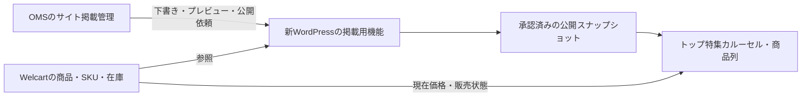

# サイト掲載管理とOMSの連携案（v46）

2026-11-20。サイト側の担当はフロントの部品・表示条件・接続契約まで。OMS本体とWordPressプラグインは未実装。

## おすすめの役割分担

掲載設定の正本は新しい開発先のWordPress、商品価格・SKU・在庫・受注はWelcart、OMSは担当者が操作する管理画面とする。価格や在庫を特集JSONに複製しない。初期はWordPressだけで掲載管理でき、その後OMSから同じ設定へ接続できる。

CMSへ一元化する理由は、サイトの画像・URL・分類・権限・公開状態と同じ場所で管理できること。OMSを正本にする案も可能だが、サイトと二重に編集する運用を避けたい。受注データのテーブルを掲載設定用に流用しない。既存本店DB／バックアップは変更せず、新しい開発先に専用のカスタム投稿タイプとメタ等を作る案。

## 管理画面で操作するもの

- 特集1枚：固定ID、種類（4商品／特集リンク集）、見出し・説明・テーマ色・画像・リンク、4商品IDまたは特集バナー群。
- 掲載先：トップ特集カルーセル、商品列、サイド枠。順番と表示／停止を持つ。
- 掲載開始・終了日時は画面に「日本時間」と明示。開始を含み、終了を含まない。保存は時差付きISOまたはUTCで、Thai端末の現地時間に勝手に解釈させない。
- 状態：下書き／予約／公開中／終了／手動停止。終了したものは削除せず再利用できる。
- プレビュー、変更履歴、承認して公開、公開済み版への差し戻し、接続失敗時の表示。

クリスマス見本は2026-11-01 00:00から2026-12-26 00:00まで（+09:00）。毎年自動延長せず、次年に内容・在庫・写真を確認して再設定する。終了で商品や中カテゴリーを消さず、広告枠だけを隠す。

## 今回のサンプルで準備した接続単位

| 設定 | 編集元 |
|---|---|
| 特集カード1枚 | site-src/home-promos/ID.json |
| 特集の順番 | site-src/home-promos/manifest.json |
| 旧枠の保持／非表示・季節のサイド広告 | site-src/home-layout.json |
| 売れ筋TOP10の10商品 | site-src/ranking-top10.json |
| 表示期間の共通判定 | placement-visibility.js |

フィールドはactive、startsAt、endsAt、timeZone、kind、theme、title、text、href、cta、ids（4商品）、tiles（特集リンク群）。公開表示では設定漏れを表示とみなさず、終了時刻で非表示。開いたままでも1分ごととタブ復帰時に再判定する。これはサンプル用のブラウザ時計判定。本番は必ずサーバー時計で同じ判定を行い、公開キャッシュの有効期限を次の開始／終了境界までに制限する。cronだけに終了処理を任せない。旧枠はソースを保持しactive:falseで隠している。

## 本番接続の提案（まだ存在しないAPI）

例：/wp-json/lunaluce/v1/site-content。これは提案名であり現在のサイトに実装済みのURLではない。

1. OMSが現行版とrevisionを取得。
2. 下書きを保存。サーバーで商品ID・権限・URL・画像・期間・4商品の選択を検証。
3. 承認者がプレビューし公開。If-Matchなどで同時編集の上書きを拒否。
4. WordPressが新しい公開版を作り、サイトが切り替える。失敗したら最後の正常版を維持し、管理画面に失敗を示す。
5. 公開用レスポンスには顧客・注文・認証情報・内部メモを含めない。

商品IDは新WordPressの投稿IDと同じと決めつけず、現行catalogProductIdと移行後Welcart商品／SKUを対応づける。画像は元比率を維持し、バナー枠16:9へobject-fit:containで収める。価格・割引・在庫は販売マスタで検証し、実施していないセールを広告しない。

## 認証と対象バージョン

WordPress内の管理画面はログインCookie＋nonce＋権限で保護し、OMSからのサーバー間連携は新開発先で使える方式を確認する。対応版ではApplication Passwords等を検討できるが、認証情報を静的HTML／GitHub Pagesへ埋め込まない。バックアップのWordPress5.2系と新しい対象バージョンを区別し、このために古い本店を更新しない。

公式資料：
- [投稿の日時・公開状態](https://developer.wordpress.org/rest-api/reference/posts/)
- [カスタム投稿タイプのREST対応](https://developer.wordpress.org/rest-api/extending-the-rest-api/adding-rest-api-support-for-custom-content-types/)
- [REST API認証・権限](https://developer.wordpress.org/rest-api/using-the-rest-api/authentication/)

